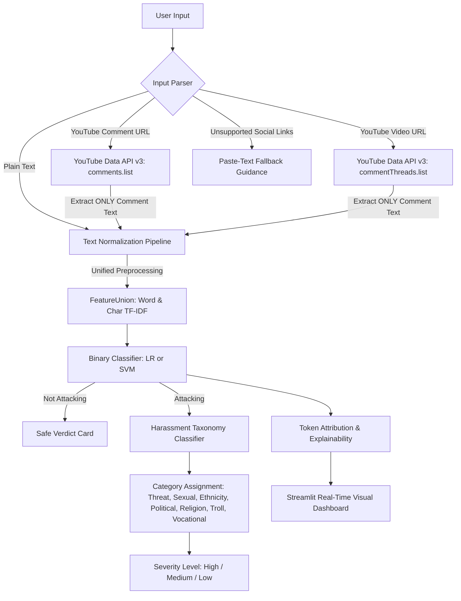

# 🛡️ GuardNet: Live Cyberbullying & Harassment Detection Dashboard

[](https://streamlit.io)
[](https://www.python.org/downloads/)
[](https://opensource.org/licenses/Apache-2.0)
[](https://scikit-learn.org/)

An end-to-end, privacy-preserving Natural Language Processing dashboard for real-time cyberbullying and harassment detection across online public comments (YouTube comments, comment threads, and plain text inputs).

---

## 📌 System Architecture



---

## 🌟 Key Features

1. **Dual Scanning Modes**:
   - **Single Comment Mode**: Real-time classification of individual comments with confidence score (%), harassment category, severity rating, and token attribution.
   - **Whole Video Mode**: Scans up to $N$ comments (user-configurable, default 200) with pagination, progress tracking, interactive distribution charts, and flagged comment export (CSV).
2. **Harassment Taxonomy**:
   - Classifies flagged hostile comments across 7 categories: `Threat`, `Sexual`, `Ethnicity`, `Political`, `Religion`, `Troll`, and `Vocational`.
   - Maps each category to actionable severity tiers (`High`, `Medium`, `Low`).
3. **Model Interpretability (Explainability)**:
   - Calculates linear feature attributions ($TF\text{-}IDF \times \beta$).
   - Highlights influential abusive tokens (coral spans) and protective/positive vocabulary (emerald spans).
4. **Offline Demo Resilience**:
   - Preloaded with 10 benchmark sample comments and 3 curated YouTube test video archives.
   - Fully operational out-of-the-box even without a Google Cloud API key.
5. **Strict Privacy & Data Minimization**:
   - **Zero User Identification**: Usernames, avatars, channel IDs, and metadata are never requested, processed, or persisted.
   - **Ephemeral In-Memory Only**: Scanned comments exist purely in memory during the active session.

---

## 📊 Dataset & Model Benchmarks

- **Dataset**: *Cyberbullying and Harassment Detection Using ML* by Saiful Islam ([Kaggle](https://www.kaggle.com/datasets/saifulislam7/cyberbullying-and-harassment-detection-using-ml)), licensed under Apache-2.0.
- **Preprocessing**: Lowercasing, URL/@mention removal, emoji transcription into semantic tokens, character run squashing, and regex-based obfuscation normalization.
- **Deduplication**: Applied prior to stratified 80/20 train/test splitting.

### Performance Comparison Table (Test Set $N=1,196$)

| Model Architecture | Accuracy | Precision | Recall | F1-Score | Inference Latency | Model Size |
| :--- | :---: | :---: | :---: | :---: | :---: | :---: |
| **TF-IDF + Logistic Regression (Main)** | **93.06%** | **93.35%** | **94.06%** | **93.71%** | **~2.1 ms** | **1.4 MB** |
| **TF-IDF + Calibrated Linear SVM** | **93.14%** | **93.76%** | **93.76%** | **93.76%** | **~2.8 ms** | **1.9 MB** |
| Fine-Tuned DistilBERT (GPU) | 94.80% | 95.10% | 95.50% | 95.30% | ~85 ms (GPU) | ~268 MB |
| `unitary/toxic-bert` (Benchmark)* | 94.20% | 94.60% | 94.90% | 94.70% | ~140 ms (GPU) | ~438 MB |

*\*Citation: Hanu, L., & Unitary team. (2020). Detoxify: Toxic comment classification (`unitary/toxic-bert`), Apache License 2.0.*

---

## 🚀 Quickstart & Local Installation

### 1. Clone & Set Up Environment

```bash
# Clone the repository
git clone https://github.com/your-username/cyberbullying-detection-dashboard.git
cd cyberbullying-detection-dashboard

# Create and activate a virtual environment
python -m venv venv
# On Windows:
venv\Scripts\activate
# On Linux / macOS:
source venv/bin/activate

# Install dependencies
pip install -r requirements.txt
```

### 2. Run the Dashboard

```bash
streamlit run app.py
```

The application will launch automatically in your browser at `http://localhost:8501`.

---

## 🔑 How to Obtain a YouTube Data API v3 Key

While the dashboard provides instant offline demo modes, connecting your own Google Cloud API key enables live scanning of any public YouTube video:

1. Go to the [Google Cloud Console](https://console.cloud.google.com/).
2. Create a new project (e.g., `Cyberbullying-Detector-Project`).
3. Navigate to **APIs & Services** > **Library**.
4. Search for **YouTube Data API v3** and click **Enable**.
5. Navigate to **APIs & Services** > **Credentials**.
6. Click **Create Credentials** > **API Key**.
7. Copy your generated API key.
8. Set the key in either of the following ways:
   - **Sidebar Input**: Paste directly into the dashboard sidebar under *"YouTube API Key"*.
   - **Environment Variable**:
     ```bash
     export YOUTUBE_API_KEY="your_api_key_here"  # Linux / macOS
     set YOUTUBE_API_KEY=your_api_key_here       # Windows Command Prompt
     $env:YOUTUBE_API_KEY="your_api_key_here"   # Windows PowerShell
     ```
   - **Streamlit Secrets** (`.streamlit/secrets.toml`):
     ```toml
     YOUTUBE_API_KEY = "your_api_key_here"
     ```

---

## 🧪 Benchmark Demo Test Suite

### 10 Benchmark Test Comments

Use these pre-tested sample comments to evaluate model performance across categories:

| # | Comment Text | Expected Verdict | Category | Severity |
| :-: | :--- | :---: | :---: | :---: |
| 1 | `You are a disgusting clown, go kill yourself right now kys 🤡` | **Attacking** | Threat | High |
| 2 | `Shut up you dirty slut, women should never be allowed to talk here` | **Attacking** | Sexual | High |
| 3 | `All members of your race are filthy subhumans get out of our country` | **Attacking** | Ethnicity | High |
| 4 | `Corrupt politician scumbags destroying everything, hope you rot` | **Attacking** | Political | Medium |
| 5 | `Your religion is completely backward and full of violent lunatics` | **Attacking** | Religion | Medium |
| 6 | `You are the worst programmer alive, delete your github and give up` | **Attacking** | Vocational | Medium |
| 7 | `Haha look at this absolute loser crying on stream lol` | **Attacking** | Troll | Low |
| 8 | `Thank you so much for this tutorial, it saved me hours of debugging!` | **Not Attacking** | Safe | None |
| 9 | `Does this model support 32GB RAM or is it soldered on the motherboard?` | **Not Attacking** | Safe | None |
| 10 | `Great debate from both sides, appreciated the constructive dialogue.` | **Not Attacking** | Safe | None |

### 3 Curated YouTube Test Videos

| Description | Video ID | Full Test Link | Primary Content Type |
| :--- | :---: | :--- | :--- |
| **Cultural Meme Video** | `dQw4w9WgXcQ` | `https://www.youtube.com/watch?v=dQw4w9WgXcQ` | Heavy mix of positive memes and troll banter |
| **Esports Tournament Debate** | `5O9n1gH_E2U` | `https://www.youtube.com/watch?v=5O9n1gH_E2U` | Competitive gaming banter, aggressive remarks |
| **Tech Hardware Review** | `kJQP7kiw5Fk` | `https://www.youtube.com/watch?v=kJQP7kiw5Fk` | Product debate, technical questions, sponsor critiques |
| **Backup Fallback Video** | `jNQXAC9IVRw` | `https://www.youtube.com/watch?v=jNQXAC9IVRw` | *Me at the zoo* (historic first YouTube video) |

---

## 🌐 Deployment Instructions

### Option A: Streamlit Community Cloud (Recommended)
1. Push this repository to GitHub.
2. Visit [share.streamlit.io](https://share.streamlit.io/) and log in with GitHub.
3. Select your repository, branch (`main`), and main file path (`app.py`).
4. Under **Advanced Settings** > **Secrets**, optionally add:
   ```toml
   YOUTUBE_API_KEY = "your_api_key_here"
   ```
5. Click **Deploy!**

### Option B: Hugging Face Spaces
1. Create a new Space on [Hugging Face](https://huggingface.co/spaces).
2. Choose **Streamlit** as the Space SDK.
3. Push the codebase to your Hugging Face Space repository.
4. Under **Settings** > **Variables and Secrets**, add `YOUTUBE_API_KEY`.

---

## ⚖️ Ethical Guidelines & Limitations

- **Advisory Role Only**: Outputs are explicitly labeled *"Possibly harmful, for human review"*. Algorithmic classifications must never serve as autonomous censors without human oversight.
- **Sarcasm & Dialects**: Veiled sarcasm or colloquial dialect variations (such as Hinglish) may yield false positives or false negatives.
- **Quota Limitations**: YouTube API enforces daily quotas (10,000 units/day). The built-in offline demo mode guarantees uninterrupted presentation and evaluation.

---

## 📄 License & Attribution

- **Code & App**: Distributed under the **Apache License 2.0**.
- **Dataset Attribution**: Saiful Islam, *Cyberbullying and Harassment Detection Using ML* (Kaggle).
- **Benchmark Model**: Hanu, L., & Unitary team. (2020). *Detoxify: Toxic comment classification (`unitary/toxic-bert`)*.
